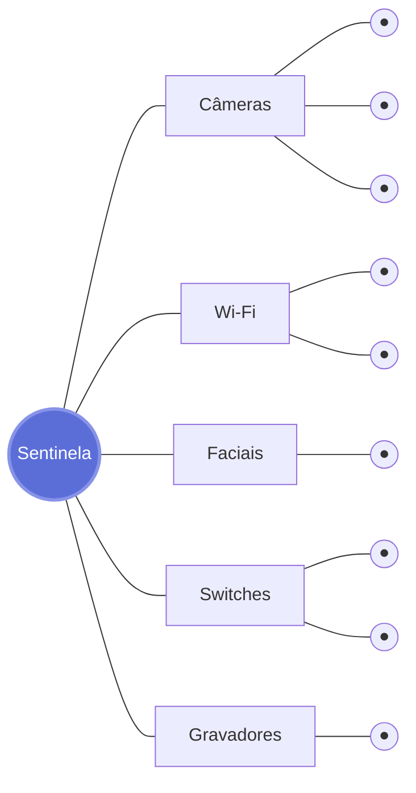
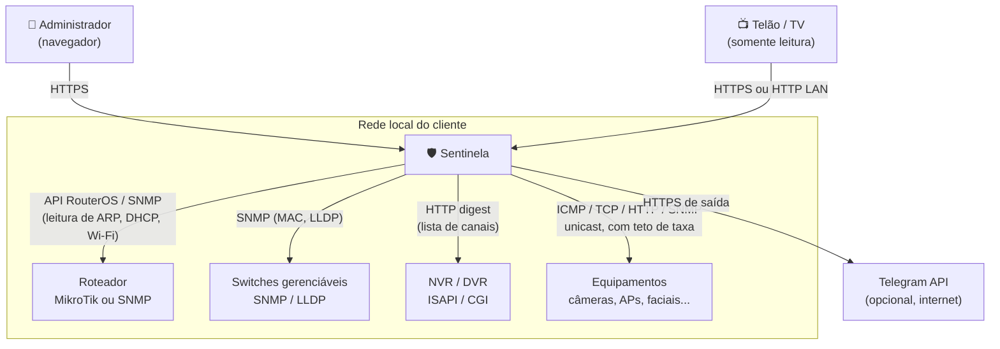
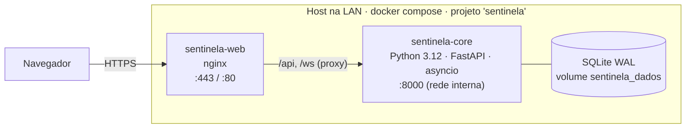
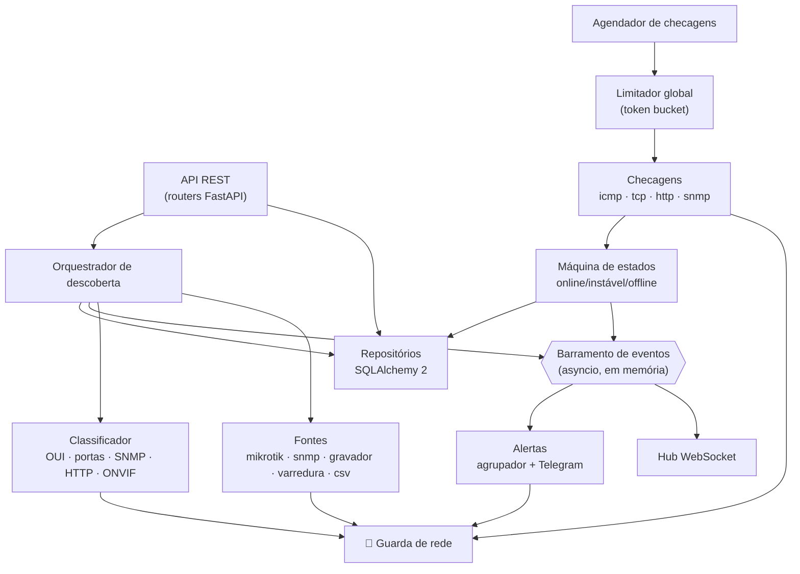
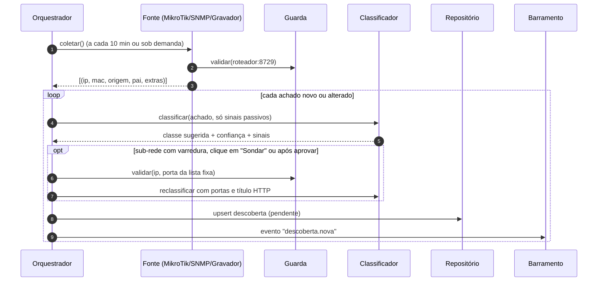
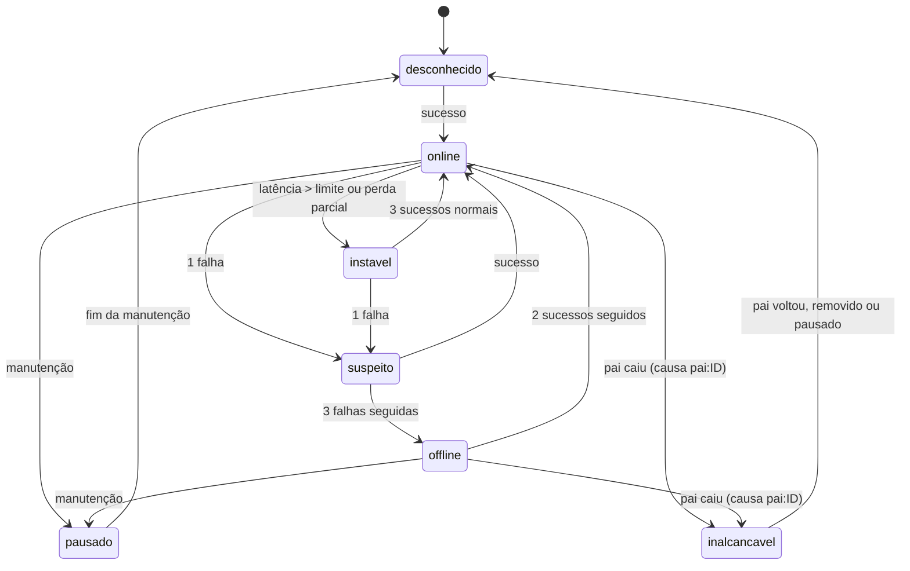

# Sentinela — Projeto Arquitetônico

> Versão 1.0 · 2026-11-16 · Status: **proposta para aprovação**
> Documento de requisitos e decisões de produto: [`docs/superpowers/specs/2026-11-16-sentinela-design.md`](../superpowers/specs/2026-11-16-sentinela-design.md)

## Sumário

1. [Visão geral](#1-visão-geral)
2. [Requisitos de qualidade](#2-requisitos-de-qualidade)
3. [Contexto (C4 nível 1)](#3-contexto-c4-nível-1)
4. [Containers (C4 nível 2)](#4-containers-c4-nível-2)
5. [Componentes do núcleo (C4 nível 3)](#5-componentes-do-núcleo-c4-nível-3)
6. [Guarda de rede: a garantia de zero broadcast](#6-guarda-de-rede-a-garantia-de-zero-broadcast)
7. [Descoberta](#7-descoberta)
8. [Classificação](#8-classificação)
9. [Monitoramento e orçamento de tráfego](#9-monitoramento-e-orçamento-de-tráfego)
10. [Modelo de dados](#10-modelo-de-dados)
11. [API e tempo real](#11-api-e-tempo-real)
12. [Interface](#12-interface)
13. [Segurança e modelo de ameaças](#13-segurança-e-modelo-de-ameaças)
14. [Implantação e operação](#14-implantação-e-operação)
15. [Estrutura do repositório](#15-estrutura-do-repositório)
16. [Estratégia de testes](#16-estratégia-de-testes)
17. [Registro de decisões (ADR)](#17-registro-de-decisões-adr)
18. [Roteiro de entrega](#18-roteiro-de-entrega)
19. [Riscos](#19-riscos)

---

## 1. Visão geral

O Sentinela é um monitor de equipamentos de rede **instalado dentro da rede local**. Ele descobre os equipamentos sem gerar broadcast, classifica cada um (câmera, AP Wi‑Fi, controle facial, switch...) e mostra o estado de todos numa **teia 3D**: o servidor no centro, um nó por classe ao redor, e os equipamentos orbitando o nó da sua classe.



Três princípios orientam todas as decisões:

1. **Pergunte a quem já sabe.** Roteadores, switches e gravadores já conhecem os equipamentos. Ler as tabelas deles não custa nada à rede.
2. **Toda saída de pacote passa por um único guarda.** Um ponto só do código decide se um destino é permitido, e ele recusa broadcast, multicast e endereço fora das sub-redes declaradas.
3. **Bonito e leve ao mesmo tempo.** O 3D é carregado sob demanda e se degrada sozinho em hardware fraco.

## 2. Requisitos de qualidade

| Atributo | Meta mensurável |
|---|---|
| Tráfego na rede | ≤ 20 pacotes/s em regime (ajustável até 100); **0 pacotes** para broadcast/multicast |
| Detecção de queda | ≤ 45 s nas classes críticas e ≤ 3 min nas demais, até 1.000 equipamentos |
| Capacidade | 2.000 equipamentos por instalação |
| Recursos do host | ≤ 512 MB de RAM e ≤ 10% de CPU médio num Raspberry Pi 4 com 1.000 equipamentos |
| Interface | primeira tela ≤ 150 KB gzip; LCP < 2,5 s; teia 3D a 60 fps com 1.000 nós em notebook comum |
| Disponibilidade | reinício automático; volta a monitorar em < 30 s após boot do host |
| Persistência | perda máxima de 5 min de amostras em queda de energia; eventos de estado nunca se perdem |
| Privacidade | nenhuma saída à internet além do Telegram, e só se configurado |

## 3. Contexto (C4 nível 1)



## 4. Containers (C4 nível 2)



| Container | Responsabilidade | Exposição | Limites |
|---|---|---|---|
| `sentinela-web` | TLS, arquivos estáticos do front, proxy de `/api` e `/ws`, cabeçalhos de segurança, limite de payload e de taxa | `443` na LAN; `80` redireciona (e opcionalmente serve `/parede` em HTTP) | 64 MB, 0,25 CPU |
| `sentinela-core` | API, WebSocket, descoberta, classificação, agendador de checagens, alertas, persistência | só rede interna do compose | 512 MB, 1 CPU |

O núcleo é **um processo único** com `asyncio`. Não há fila externa nem Redis: o volume de trabalho (dezenas de checagens por segundo) cabe folgado num laço de eventos, e um processo só elimina coordenação e concorrência no SQLite.

## 5. Componentes do núcleo (C4 nível 3)



| Componente | Faz | Não faz |
|---|---|---|
| Guarda de rede | valida **todo** destino antes de qualquer envio | não envia nada sozinho |
| Fontes | leem tabelas de quem já conhece a rede | não sondam IP desconhecido (exceto a varredura opcional) |
| Classificador | pontua sinais e sugere classe | não sobrescreve correção manual |
| Agendador | distribui checagens no tempo, por prioridade | nunca passa do teto do limitador |
| Máquina de estados | aplica histerese (3 falhas = offline) | não decide intervalo |
| Barramento | publica mudanças para WebSocket e alertas | não persiste (quem persiste é o repositório) |

## 6. Guarda de rede: a garantia de zero broadcast

Todo código que abre socket recebe o destino **já validado**: `guarda.validar(ip, porta, protocolo)` devolve um `DestinoAutorizado` ou lança `DestinoProibido`. As checagens e fontes só aceitam `DestinoAutorizado` no tipo, então esquecer a validação não passa no `mypy`.

Regras do guarda:

| Recusa | Motivo |
|---|---|
| `255.255.255.255` e o endereço de broadcast de cada sub-rede declarada | broadcast |
| endereço de rede (`.0` de um /24, por exemplo) | broadcast legado |
| `224.0.0.0/4`, `ff00::/8` | multicast (mDNS, SSDP, WS-Discovery) |
| `0.0.0.0/8`, `127.0.0.0/8`, `169.254.0.0/16` | inválido, loopback, link-local |
| IP fora das sub-redes declaradas pelo administrador | escopo |
| sub-rede declarada que não seja RFC 1918 (exceto IP público explícito de um equipamento cadastrado) | evitar varrer a internet |

Além do guarda, há três barreiras extras:
- **Nenhum socket com `SO_BROADCAST`** (teste estático procura essa flag no código).
- **Nenhuma biblioteca de descoberta por multicast** nas dependências (lista de bloqueio verificada no CI).
- **Prova de captura** (`testes-rede/`, job `captura` do CI): núcleo e simuladores de MikroTik, switch SNMP e gravador numa rede bridge isolada, com o `tcpdump` dono do namespace de rede do núcleo; uma rodada completa (testar, confiar, coletar, aprovar, sondar, varrer um /28) e o analisador reprova qualquer quadro do Sentinela com destino broadcast/multicast, exceto o ARP request para IPs autorizados (hosts das fontes, aprovados, sondados, faixa varrida), contado e relatado.

> Transparência: num segmento IPv4 local, o **sistema operacional** emite um pedido ARP (broadcast) na primeira vez que fala com um IP ainda não presente no seu cache. É o único broadcast que o Sentinela provoca, e só nos casos autorizados do ADR 011: os **hosts das fontes** cadastradas pelo admin (roteador, switch, gravador), a **varredura** opcional (desligada por padrão, só em sub-rede com `permite_varredura`, 2 IPs/s, sinalizada na tela e cancelada na hora se a permissão cair), o clique **"Sondar"** do admin (auditado) e a **verificação pós-aprovação** (1 eco ICMP e a sondagem de portas do equipamento recém-aprovado); depois disso, o monitoramento dos aprovados. A classificação de pendentes é passiva e não gera ARP. Depois da primeira resposta, o kernel renova as entradas por unicast; IP que nunca responde (aparelho desligado) é procurado de novo a cada checagem.

## 7. Descoberta

### 7.1 Fontes

| Fonte | Protocolo | O que lê | Credencial |
|---|---|---|---|
| **MikroTik** | API RouterOS 8729 (TLS) por padrão; 8728 (sem TLS) só com aviso | `/ip/arp`, `/ip/dhcp-server/lease`, `/ip/neighbor`, `/interface/wireless/registration-table` (v6) ou `/interface/wifi/registration-table` (v7) | usuário do grupo `read` |
| **SNMP** (roteador/switch de qualquer marca) | SNMP v2c ou v3 | `IP-MIB::ipNetToPhysicalTable` (fallback `ipNetToMediaTable`), `Q-BRIDGE-MIB::dot1qTpFdbTable` / `BRIDGE-MIB`, `LLDP-MIB`, `SNMPv2-MIB::sys*` | comunidade ou usuário v3 |
| **Gravador** (NVR/DVR) | HTTP ou HTTPS, Digest (HTTPS com impressão confiada, como o MikroTik) | Hikvision ISAPI: `/ISAPI/ContentMgmt/InputProxy/channels` e `/status`; Dahua/Intelbras: `/cgi-bin/configManager.cgi?action=getConfig&name=RemoteDevice` e estado dos canais | usuário somente visualização do gravador |
| **CSV** | arquivo | nome, IP, MAC, classe, pai | — |
| **Varredura lenta** | ICMP; sondagem TCP só de quem respondeu | IPs de uma sub-rede com `permite_varredura`, 2 IPs/s, prioridade baixa, cancelável | — |

Câmeras atrás do gravador viram equipamentos **filhos** do gravador, com estado lido do próprio gravador (o Sentinela não fala direto com elas, porque estão numa rede interna do NVR). A leitura dos canais tem prioridade normal (é monitoramento) e custo 1 por gravador; se falhar, os filhos vão para `desconhecido` com a causa "gravador sem resposta".

MikroTik por TLS (8729) por padrão, com o certificado fixado pela impressão SHA-256 que o admin confirma no primeiro teste ("Confiar neste certificado", auditado); impressão diferente depois bloqueia a coleta até nova confirmação. A API sem TLS (8728) existe só para RouterOS antigo e mostra um aviso na tela (usuário e senha trafegam em claro na rede local). Credenciais cifradas com Fernet (`SENTINELA_CHAVE_CREDENCIAIS`), nunca devolvidas pela API (`credencial_definida: bool`) nem escritas em log ou auditoria.

### 7.2 Fluxo



Regras: a identidade de um equipamento é o **MAC**, quando houver; senão, o IP. A mudança de IP de um MAC conhecido atualiza o cadastro, não cria outro (se o IP novo já é de outro equipamento, nada muda e a descoberta fica com o selo de conflito). Câmeras de gravador têm chave própria (`nvr:<fonte>:<canal>`). Descobertas ficam **pendentes** até aprovação; o administrador pode ligar "aprovar automaticamente a partir de 80% de confiança" (desligado por padrão). Achado fora das sub-redes declaradas fica visível com selo, mas só pode ser aprovado depois de declarar a sub-rede: o guarda continua sendo a única autoridade.

## 8. Classificação

Motor de pontuação simples e auditável. Cada regra (`sentinela/descoberta/classificador/regras.toml`, lida com `tomllib` da biblioteca padrão, ADR 010) diz: condições → pontos por classe, com uma descrição que a tela mostra como motivo.

```toml
[[regra]]
id = "fabricante-video"
descricao = "Fabricante {fabricante}"
quando = { fabricante_contem = ["Hikvision", "Dahua", "Intelbras"] }
pontos = { camera = 30, gravador = 20 }

[[regra]]
id = "porta-rtsp"
descricao = "Porta 554 (vídeo RTSP) aberta"
quando = { porta_aberta = 554 }
pontos = { camera = 40, gravador = 25 }

[[regra]]
id = "origem-canal-gravador"
descricao = "Aparece como canal de um gravador"
quando = { origem = "gravador_canal" }
pontos = { camera = 60 }
```

- **Classificação passiva** (ADR 011): a descoberta pendente é classificada só com o que as fontes já contaram (OUI do MAC, nome DHCP, identidade/plataforma de `/ip/neighbor`, registro Wi‑Fi, SNMP/LLDP, dados do gravador). Nenhum pacote vai ao aparelho para classificá-lo, porque o primeiro contato com um IP do segmento provoca um ARP (broadcast).

- Confiança = pontos da classe vencedora ÷ soma dos pontos, com limiar de 50 pontos absolutos para sair de "Desconhecidos".
- Sinais coletados ficam salvos em JSON na descoberta. A tela mostra **por que** o Sentinela achou que era uma câmera.
- Base OUI da IEEE embutida e atualizável por comando (`sentinela oui-atualizar`), sem download em tempo de execução.
- A sondagem de portas usa **só a lista fixa** (22, 23, 80, 443, 554, 4370, 8000, 8080, 8291, 9100, 37777, 3389), TCP connect, uma conexão por vez por IP, 1 s de limite, prioridade baixa; título HTTP só com 80/443/8080 abertas (`GET /`, 2 s, até 16 KB, sem seguir redirecionamento para outro host). Ela só roda em sub-rede com `permite_varredura`, quando o admin clica "Sondar" (auditado) ou depois da aprovação, e no máximo uma vez por dia por achado.

## 9. Monitoramento e orçamento de tráfego

### 9.1 Agendamento

- Cada equipamento tem **próxima execução** numa fila de prioridade (heap por horário).
- Intervalo base por classe: críticas (câmeras, gravadores, controle de acesso, roteadores, switches) 15 s; demais 60 s. Variação aleatória de ±20%.
- **Limitador global token bucket**: capacidade = teto (padrão 20 tokens/s). Uma checagem ICMP custa 1 token; TCP 1; HTTP 3; SNMP 1.
- Se a demanda passar do teto, os intervalos são **esticados proporcionalmente**, primeiro nas classes não críticas. O painel mostra "detecção máxima atual: 38 s" e avisa se passar das metas.
- Após falha, a confirmação acontece mais rápido: re-checagem em 5 s, até 3 tentativas (com prioridade no limitador).

### 9.2 Máquina de estados



`inalcancavel` (Fase 4A) é o estado do filho cujo pai caiu: a checagem do filho é suspensa enquanto o pai está fora, e o evento guarda a causa `pai:<id do pai>`. Se o pai volta, é removido, perde o `pai_id` ou é pausado, o filho volta a `desconhecido` e é checado de novo (nunca fica preso, nem após reinício do núcleo). Mostra-se com a cor do pausado (`#7A8194`) e um ícone de elo partido na Teia, no Organograma, na Lista e na legenda: status nunca só por cor.

"Suspeito" não aparece como vermelho na tela (só um leve tremor da esfera) e não gera alerta. Isso elimina o pisca-pisca.

### 9.3 Conta de tráfego (exemplo)

| Cenário | Checagens/s | Pacotes/s (ida+volta) | Banda |
|---|---|---|---|
| 300 equipamentos (150 críticos) | 150/15 + 150/60 = 12,5 | ~25 | ~2 KB/s |
| 1.000 (500 críticos) | 41,7 → limitado a 20 | ~40 | ~5 KB/s |
| Descoberta MikroTik, 1.000 entradas | rajada única a cada 10 min | 1 conexão TCP | ~150 KB por coleta |

É uma fração ínfima de qualquer enlace (uma única câmera em 1080p usa ~4.000 KB/s).

### 9.4 Correlação de quedas

Regras implementadas (Fase 4A, `alertas/agrupador.py`):

- **Janela retroativa de 60 s:** quando um pai cai, os filhos que já tinham caído nos 60 s anteriores ou que caem nos seguintes entram no mesmo alerta; os que estavam online passam a `inalcancavel`. A hierarquia vale até a profundidade 8; ciclo no `pai_id` é recusado.
- **Um alerta, uma mensagem:** o principal é o pai (ou o gravador, quando ele responde a ping mas a leitura de canais falha); `quedas` guarda quem caiu por conta própria e `afetados` todos os demais (quedas agrupadas mais filhos inalcançáveis). Ex.: "Switch Bloco B caiu às 14:32 — 14 equipamentos afetados".
- **Quedas sem pai comum** dentro de 30 s agrupam-se num alerta só.
- **Caiu e voltou em menos de 2 min** (`breve`): se ainda não foi enviado, sai uma mensagem "caiu e voltou"; se já foi, a mensagem enviada é editada (`editMessageText`), sem mensagem de volta.
- **`instavel`** só alerta classe crítica e depois de 5 min; **`fonte_falhou`** após 3 coletas seguidas com erro.
- **Silêncio e manutenção** (`alertas/silencios.py`): o alerta é registrado com `silenciado=true` e nada vai ao Telegram. A manutenção do pai cobre a cadeia de descendentes; manutenções sobrepostas só retomam o equipamento quando a última termina, e a pausa manual feita durante a manutenção não é desfeita.
- Membro de queda que é pausado ou removido conta como resolvido para fechar o alerta (sem volta); o alerta fecha quando volta o último membro.


## 10. Modelo de dados

```mermaid
erDiagram
    CLASSE ||--o{ EQUIPAMENTO : agrupa
    EQUIPAMENTO ||--o{ EQUIPAMENTO : "pai de"
    EQUIPAMENTO ||--o{ EVENTO : registra
    EQUIPAMENTO ||--o{ AMOSTRA : mede
    FONTE ||--o{ DESCOBERTA : produz
    DESCOBERTA }o--o| EQUIPAMENTO : "vira"
    USUARIO ||--o{ AUDITORIA : faz

    CLASSE { int id; text slug; text nome; text cor; text icone; int intervalo_s; bool critica; int ordem }
    EQUIPAMENTO { uuid id; text nome; text ip; text mac; text fabricante; int classe_id; text classe_origem; real confianca; uuid pai_id; text porta_pai; text checagem; text alvo; text estado; datetime estado_desde; real latencia_ms; bool pausado; datetime visto_em }
    EVENTO { int id; uuid equipamento_id; text de; text para; datetime em; int duracao_s; text causa }
    AMOSTRA { uuid equipamento_id; datetime ts; real latencia_ms; bool ok }
    FONTE { int id; text tipo; text nome; text host; int porta; blob credencial_cifrada; bool ativa; datetime ultima_coleta; text ultimo_erro }
    DESCOBERTA { int id; text ip; text mac; json sinais; text classe_sugerida; real confianca; int fonte_id; text status }
    USUARIO { int id; text login; text hash_argon2; text papel; text totp_cifrado; int falhas; datetime bloqueado_ate }
    AUDITORIA { int id; int usuario_id; text acao; text alvo; json antes; json depois; text ip; datetime em }
```

Tabelas auxiliares: `sub_rede` (cidr, permite_varredura), `config` (chave/valor tipado; a Fase 4A usa as chaves `telegram`, `telegram_status` e `paredes_http`), `amostra_5min` (agregado), `sessao` (refresh com `jti`, revogável).

Tabelas da Fase 4A (migração Alembic `0004`, reversível):

| Tabela | Conteúdo |
|---|---|
| `alerta` | `tipo` (`queda`, `volta`, `instavel`, `fonte_falhou`), equipamento ou fonte, `quedas`, `afetados`, `voltaram`, `aberto_em`/`fechado_em`, `breve`, `reconhecido_por/em`, `silenciado`, estado do envio (`envio` = `nao_aplica`, `pendente`, `enviado`, `falhou`; tentativas, próxima tentativa, `enviado_para`, `telegram_msgs`). Retenção de 90 dias |
| `silencio` | silêncio ou manutenção, alvo por equipamento ou classe, `inicio`/`fim` (fim obrigatório, ≤ 30 dias), motivo, `pausados` (ids pausados pela manutenção, para retomar só esses) |
| `parede` | telão pareado: nome, **hash** do token, modo `https`/`http`, `ip_vinculado` (só modo http), último acesso/IP, `revogada_em` |
| `parede_pedido` | pedido de pareamento: hash do código, hash do segredo de consulta, IP, validade de 10 min, aprovação e consumo |

O `downgrade` converte `inalcancavel` em `offline` (equipamento e eventos), remove as tabelas e apaga as chaves de `config` da fase. O banco continua em UTC; o fuso (`SENTINELA_FUSO`) só vale para textos e atalhos de silêncio.

**Retenção:** `amostra` 48 h; `amostra_5min` 30 dias; `evento` 1 ano; `auditoria` 1 ano. Limpeza diária às 03:00.
**Escrita:** amostras acumulam em memória e gravam em lote a cada 60 s (uma transação). Eventos de estado gravam na hora.
**Migrações:** Alembic desde a primeira tabela.

## 11. API e tempo real

REST em `/api/v1`, JSON, autenticação por cookie de sessão (`HttpOnly`, `Secure`, `SameSite=Strict`) + token CSRF em escrita.

| Recurso | Operações |
|---|---|
| `/auth` | login, logout, refresh, TOTP |
| `/equipamentos` | listar (filtro por classe/estado, paginação ≤ 100), ver, criar, editar, pausar, excluir, histórico |
| `/classes` | listar, editar cor/ícone/intervalo |
| `/descobertas` | listar pendentes, aprovar, ignorar, aprovar em lote |
| `/fontes` | CRUD, testar conexão, coletar agora (credenciais nunca retornam) |
| `/topologia` | grafo pronto para a teia: nós e ligações |
| `/eventos` | linha do tempo filtrável |
| `/config`, `/usuarios`, `/auditoria` | administração (papel admin) |
| `/alertas` | listar (filtros, paginação ≤ 100), ver, `POST /{id}/reconhecer` |
| `/silencios` | listar, criar (silêncio ou manutenção, com fim), `POST /{id}/encerrar` |
| `/config/telegram` | ver (token nunca retorna), `PATCH`, `POST /teste` (409 na demonstração) |
| `/paredes`, `/config/paredes` | listar telões, aprovar código, revogar; chave "telão sem HTTPS" |
| `/parede/pedido`, `/parede/snapshot` | **sem sessão** (a TV): pedir código, consultar, ler o retrato reduzido; isentas de CSRF e limitadas por IP |
| `/saude` | healthcheck sem dados sensíveis |

**WebSocket `/ws`** — o cliente recebe primeiro um retrato completo (`snapshot`) e depois só diferenças:

```json
{ "tipo": "estado", "id": "8f1c…", "estado": "offline", "desde": "2026-11-16T14:03:11Z", "causa": "pai" }
{ "tipo": "latencia", "lote": [["8f1c…", 3.2], ["91aa…", 1.1]] }
{ "tipo": "descoberta", "id": 412, "classe_sugerida": "camera", "confianca": 0.86 }
```

Mensagens novas da Fase 4A: `{ "tipo": "alerta", "acao": "aberto"|"atualizado"|"fechado"|"removido", "alerta": {…} }` e `{ "tipo": "silencio", "acao": "criado"|"encerrado", "id": 7 }`; o `estado` ganha `"inalcancavel"` com `causa: "pai:<id>"`.

**WebSocket `/ws/parede`** (telão): só leitura, só o token do telão; `snapshot` com `nome`, `fuso`, `classes`, `equipamentos` (apenas `id` opaco, nome, classe, estado, `pai_id`) e `alertas`, depois `estado`, `equipamento`, `alerta` e `ping`. Nunca IP, MAC, fabricante ou latência. Fecha com 4401 (sem token válido ou revogado, revalidado a cada 60 s) ou 4403 (origem).

Latências são enviadas em lote a cada 5 s. Mudanças de estado saem na hora. Reconexão automática com recuo exponencial e novo `snapshot`.

## 12. Interface

### 12.1 Pilha

HTML + CSS com tokens + **Alpine.js** nas telas comuns. **3d-force-graph** (Three.js) só na Teia, carregado por `import()` dinâmico. Sem etapa de build obrigatória além de minificação (esbuild), sem sourcemaps em produção.

### 12.2 Telas

```
┌───────────────────────────────────────────────────────────────┐
│ 🛡 Sentinela     Teia · Organograma · Lista · Alertas   ⚙  👤 │
├───────────────────────────────────────────────────────────────┤
│ ● 312 online   ◐ 4 instáveis   ● 3 offline   ◌ 2 pausados      │
│                                                               │
│                 ·  ◉ ◉ ◉                                      │
│              Câmeras ─╮         ╭─ Wi‑Fi ◉ ◉                  │
│                       ╰─( ✦ SENTINELA ✦ )─╮                   │
│         Faciais ◉ ─────╯        │         ╰─ Switches ◉ ◉ ◉   │
│                             Gravadores ◉ ◉           ┌───────┐│
│                                                      │Câmera ││
│                                                      │Portão ││
│                                                      │10.0..  ││
│                                                      │offline ││
│                                                      │há 2min ││
│                                                      └───────┘│
└───────────────────────────────────────────────────────────────┘
```

| Tela | Conteúdo |
|---|---|
| **Teia** | grafo 3D; servidor ao centro com brilho; anel de nós de classe; equipamentos em órbita; painel lateral de vidro ao clicar |
| **Organograma** | uma árvore 2D por classe (Classe → pai → equipamento), em SVG, leve, funciona no celular |
| **Lista** | tabela filtrável; vira cartões abaixo de 768 px |
| **Novos** | descobertas pendentes com sinais ("por que é câmera") e aprovação em lote |
| **Alertas** | abertos e histórico paginado com filtros, reconhecer, silêncios e manutenções (atalhos 1 h, 4 h, até amanhã 08:00 no fuso, personalizado) |
| **Configurações** | fontes, sub-redes, ritmo e teto, **Telegram** (token, chats, incluir IP, enviar teste), **Telões** (emparelhar com código, revogar, chave "sem HTTPS"), usuários |
| **Parede** (`/parede`) | sem login: mostra o código de emparelhamento; pareada, a Teia em tela cheia com rotação lenta, contadores e faixa de alertas; cai para o Organograma se FPS < 30 por 10 s; "sem conexão" após 60 s; cartão de alerta reduzido, **sem IP** |

Decisões do dono na Fase 4A: **IP dentro de cada bolinha** na Teia e no Organograma do painel (o telão não mostra IP: "só no painel"); **cartão de alerta na tela** ao cair um equipamento (painel com IP e todos os dados; telão reduzido, sem IP/MAC/fabricante/latência; som desligado por padrão); rótulos e faixa de filtros da Teia ajustados (sem corte nas bordas). A Teia do telão roda no Chromium 63 (Tizen 5) com compatibilidade reduzida.

### 12.3 Linguagem visual "quântica"

- Tema escuro padrão: fundo `#15181F`, superfície `#1B1F28`, texto `#E8EBF2`; primária `#8793E8`, acento `#68C7BC`; tema claro equivalente.
- Status: online `#4CA878`, instável `#D9A441`, offline `#D97373`, pausado `#7A8194`. **Status nunca só por cor**: forma e ícone também mudam (online cheio, instável anel, offline com pulso e "×"), por acessibilidade.
- Esferas com material emissivo suave e *halo* em sprite (barato); servidor com núcleo brilhante e anel girando devagar.
- Partículas nos fios (até 60 visíveis), indo do equipamento ao servidor a cada checagem bem-sucedida.
- Vidro (`backdrop-filter`) só em no máximo dois painéis ao mesmo tempo.
- Animações só de `transform`/`opacity`; `prefers-reduced-motion` desliga partículas, pulso e rotação.

### 12.4 Desempenho do 3D

| Situação | Comportamento |
|---|---|
| ≤ 1.000 nós | completo, com partículas |
| 1.000–3.000 | sem partículas; esferas de baixa resolução |
| > 3.000 ou FPS < 30 por 3 s | classes recolhidas em "super-nós" que expandem ao clicar |
| sem WebGL | abre o Organograma automaticamente |
| aba oculta | renderização pausada (`visibilitychange`) |
| `/parede` em TV | modo reduzido desde o início; cai para o Organograma se o FPS medido < 30 |

O layout por força roda alguns segundos e **congela** (`cooldownTicks`). Posições são salvas por equipamento para a teia não "dançar" a cada abertura.

## 13. Segurança e modelo de ameaças

| Ameaça | Exemplo | Controle |
|---|---|---|
| Acesso indevido ao painel | vizinho na LAN tenta logar | argon2id; bloqueio progressivo por login e IP; TOTP opcional para admin; erro genérico |
| Vazamento de credenciais de rede | dump do banco expõe senha do MikroTik | credenciais cifradas (Fernet); chave em `.env` (600) fora do volume do banco; mascaradas na API e nos logs |
| Escalada por credencial forte demais | usuário MikroTik com escrita | assistente exige e testa usuário de grupo `read`; avisa se tiver permissão de escrita |
| Sentinela usado como scanner | invasor com login força varredura na internet | guarda de rede: só sub-redes privadas declaradas; varredura só para admin, com auditoria |
| XSS por dado de equipamento | título HTTP malicioso de um aparelho | todo texto vindo da rede é tratado como não confiável; escape no front; CSP sem `unsafe-inline` |
| SSRF | URL de checagem HTTP aponta para serviço interno do host | checagem HTTP só para IP de equipamento cadastrado, via guarda; sem seguir redirecionamento para outro host |
| Telão roubado/clonado | código de emparelhamento vazado | código de 8 caracteres de uso único e 10 min, armazenado por hash; ≤ 10 pedidos por IP/h e ≤ 20 pendentes; token com escopo `parede` (só abre o retrato reduzido e `/ws/parede`, nunca rota de escrita), cookie `HttpOnly`/`SameSite=Strict`, hash no banco, revogável na hora; modo HTTP desligado por padrão e amarrado ao IP |
| Saída para a internet (Telegram) | token do bot vazado ou destino trocado | **única exceção** à Guarda: `DestinoExterno("telegram")` = `api.telegram.org:443`, HTTPS com verificação normal de certificado, IP resolvido sem broadcast/multicast/loopback/link-local; sem Telegram configurado nenhum pacote sai (nem DNS); token cifrado, nunca em log, auditoria ou erro; mensagens com dado mínimo (IP só se ligado) |
| Cadeia de suprimentos | dependência comprometida | versões fixadas com hash (`uv lock`); `pip-audit` e `trivy` no CI; poucas dependências |
| Dado de cliente no repositório público | print ou CSV real commitado | `gitleaks` em pre-commit e CI; `.gitignore` de `*.csv`, `dados/`, `*.sqlite`; exemplos só com `10.99.0.0/16` e MACs fictícios |
| Interrupção da rede | bug gera rajada | limitador global obrigatório; teste de carga confere o teto |

Cabeçalhos no nginx: HSTS, CSP restritiva, `X-Content-Type-Options: nosniff`, `Referrer-Policy: strict-origin-when-cross-origin`, `frame-ancestors 'none'`. OpenAPI desligado em produção. Logs JSON sem senha, token nem comunidade SNMP.

## 14. Implantação e operação

### 14.1 Requisitos do host

Linux com Docker (Debian/Ubuntu, Raspberry Pi OS 64 bits) ou Windows com Docker Desktop; 1 GB de RAM livre; 2 GB de disco; IP fixo na LAN; rota até as sub-redes/VLANs a monitorar.

### 14.2 Compose (essencial)

```yaml
name: sentinela
services:
  core:
    image: ghcr.io/lumezencio/sentinela-core:${VERSAO:-latest}
    build: ./core
    env_file: .env
    volumes: [ "sentinela_dados:/dados" ]
    sysctls: { net.ipv4.ping_group_range: "0 2147483647" }
    user: "10001:10001"
    read_only: true
    tmpfs: [ /tmp ]
    cap_drop: [ ALL ]
    security_opt: [ "no-new-privileges:true" ]
    mem_limit: 512m
    cpus: 1.0
    pids_limit: 256
    restart: unless-stopped
    logging: { driver: json-file, options: { max-size: "10m", max-file: "3" } }
    healthcheck:
      test: ["CMD", "python", "-c", "import urllib.request,sys;sys.exit(0 if urllib.request.urlopen('http://127.0.0.1:8000/saude',timeout=3).status==200 else 1)"]
      interval: 30s
  web:
    image: ghcr.io/lumezencio/sentinela-web:${VERSAO:-latest}
    build: ./web
    ports: [ "443:8443", "80:8080" ]
    depends_on: { core: { condition: service_healthy } }
    volumes: [ "./certs:/certs:ro" ]
    read_only: true
    tmpfs: [ /tmp, /var/cache/nginx, /var/run ]
    cap_drop: [ ALL ]
    security_opt: [ "no-new-privileges:true" ]
    mem_limit: 64m
    restart: unless-stopped
volumes:
  sentinela_dados:
```

As portas 443/80 ficam publicadas **na LAN**, nunca no roteador de borda. Se o host não permitir ICMP sem privilégio, o `core` recebe só `cap_add: [NET_RAW]`.

### 14.3 Ciclo de vida

| Ação | Comando |
|---|---|
| Instalar | `./install.sh` → gera `.env` (chave Fernet, segredo de sessão), CA local + certificado, sobe o compose e imprime a URL |
| Atualizar | `./update.sh` → backup do SQLite (`sqlite3 .backup`) → `git pull` → `docker compose up -d --build` → migrações → checagem de saúde → rollback automático para a imagem anterior se falhar |
| Backup | diário, local, 7 cópias rotativas; opcionalmente para pasta de rede |
| Restaurar | `./restore.sh <arquivo>` |

## 15. Estrutura do repositório

```
Sentinela/
├── core/                       # backend Python
│   ├── pyproject.toml          # uv + lock
│   ├── Dockerfile
│   ├── alembic/
│   ├── sentinela/
│   │   ├── main.py             # app FastAPI + ciclo de vida das tarefas
│   │   ├── config.py           # pydantic-settings (extra="forbid")
│   │   ├── db/                 # modelos, sessão, repositórios
│   │   ├── api/                # routers v1 + ws.py
│   │   ├── seguranca/          # senhas, sessões, csrf, totp, cripto
│   │   ├── rede/guarda.py      # 🛑 único ponto de validação de destino
│   │   ├── descoberta/
│   │   │   ├── orquestrador.py
│   │   │   └── fontes/{mikrotik,snmp,gravador_hik,gravador_dahua,csv,varredura}.py
│   │   ├── classificacao/{motor,oui,sinais}.py + regras/*.yaml
│   │   ├── monitor/{agendador,limitador,estados,correlacao}.py
│   │   │   └── checagens/{icmp,tcp,http,snmp}.py
│   │   ├── alertas/{agrupador,telegram}.py
│   │   ├── barramento.py
│   │   └── demo/simulador.py   # rede sintética para demonstração e testes
│   └── tests/
├── web/
│   ├── Dockerfile, nginx.conf
│   └── src/
│       ├── index.html, parede.html
│       ├── css/{tokens,base,componentes}.css
│       └── js/{app,ws,estado}.js + views/{teia,organograma,lista,novos,alertas,config}.js
├── docs/
│   ├── arquitetura/ARQUITETURA.md   # este documento
│   └── superpowers/specs/           # requisitos
├── install.sh, update.sh, restore.sh
├── docker-compose.yml, .env.example
├── .gitignore, .gitleaks.toml, .pre-commit-config.yaml
├── .github/workflows/ci.yml
├── LICENSE                      # AGPL-3.0
└── README.md
```

## 16. Estratégia de testes

| Camada | O que cobre | Ferramenta |
|---|---|---|
| Unidade | guarda de rede (tabela exaustiva de destinos), limitador, máquina de estados, motor de classificação, correlação de quedas | pytest |
| Contrato | fontes contra **simuladores** de RouterOS API, agente SNMP (`snmpsim`) e respostas gravadas de ISAPI/CGI | pytest + fixtures sintéticas |
| Integração | fontes contra simuladores reais (RouterOS com TLS, agente SNMP do pysnmp, gravador com Digest); migração `downgrade`/`upgrade` | pytest |
| Captura | rodada completa numa rede bridge isolada com simuladores; `tcpdump` confirma **zero broadcast/multicast** além do ARP autorizado (`testes-rede/`) | Compose + `tcpdump` + analisador sem dependências, job `captura` |
| API | autenticação, CSRF, bloqueio, papéis, mascaramento de credenciais | pytest + httpx |
| Front | 360/768/1280/1920 px, teclado, movimento reduzido, fallback sem WebGL, Lighthouse ≥ 90 nas telas 2D | Playwright |
| Desempenho | 2.000 equipamentos simulados: CPU/RAM do core; FPS da teia com 1.000 nós | script de carga + Playwright |
| Segurança | `ruff`, `bandit`, `pip-audit`, `gitleaks`, `trivy image` | CI obrigatório |

## 17. Registro de decisões (ADR)

| # | Decisão | Alternativas | Por quê |
|---|---|---|---|
| 001 | Instalação local, uma rede por instalação | agente + painel na nuvem; VPN a partir da VPS | dono escolheu local; não será vendido; nenhuma exposição à internet |
| 002 | SQLite WAL | PostgreSQL | um só escritor, poucos milhares de linhas quentes, menos RAM e manutenção; SQLAlchemy permite migrar |
| 003 | Descoberta passiva por padrão | varredura ativa, mDNS/SSDP/WS-Discovery | requisito de zero broadcast e rede sem lentidão |
| 004 | Guarda de rede único e tipado | validação espalhada | uma garantia verificável num ponto só |
| 005 | Processo único asyncio, sem fila externa | Celery/Redis | volume baixo; menos peças, menos falhas |
| 006 | Front sem framework, 3D sob demanda | React/Vue SPA | orçamento de 150 KB na primeira tela; o 3D não pesa quem não o abre |
| 007 | AGPL‑3.0 | MIT | uso livre, mas ninguém fecha o código para revender |
| 008 | Descoberta precisa de aprovação | monitorar tudo que aparecer | evita poluir a teia com celulares de visitantes; opção de aprovação automática por confiança |
| 009 | Câmeras atrás do NVR lidas pelo gravador | ignorar; rotear até a rede do NVR | essas câmeras são o caso mais comum; consultar o gravador não exige mexer na rede |
| 010 | Regras do classificador em TOML (`tomllib`) | YAML (`yaml.safe_load`) | TOML está na biblioteca padrão do Python 3.11+: nenhuma dependência nova na imagem; sintaxe sem as ambiguidades de tipo do YAML; regras validadas ao carregar (classes, condições e regex com teto) |
| 011 | Classificação passiva; sondagem só com autorização | sondar todo achado novo (portas/título) | sondar um IP inédito faz o sistema operacional emitir ARP (broadcast); a sondagem só acontece em sub-rede com varredura ligada, no clique "Sondar" (auditado) ou após a aprovação, e o teste de captura aceita ARP só para esses IPs |

| 012 | Telegram por destino externo nomeado na Guarda | liberar saída HTTPS genérica; webhook de entrada; bot local | a Guarda segue o único ponto de saída e a exceção é uma só, fixa no código (`api.telegram.org:443`), com verificação de certificado; só há saída (sem webhook, sem porta aberta) e, sem token, nenhum pacote sai |
| 013 | Código mostrado na TV e aprovado no painel | digitar código/URL na TV; QR; token na URL | TV sem teclado prático: ela exibe um código curto e o admin autenticado o aprova; uso único, 10 min, hash no banco, sem sessão na TV nem rota de escrita |

## 18. Roteiro de entrega

| Fase | Entrega | Pronto quando |
|---|---|---|
| **1. Núcleo** (concluída em 2026-11-16) | guarda de rede, cadastro manual/CSV, agendador + limitador, ICMP/TCP/HTTP, máquina de estados, lista, WebSocket, login, **modo demonstração** | 300 equipamentos simulados com estados ao vivo na lista; testes do guarda e do limitador verdes |
| **2. Visual** (concluída em 2026-11-17: Teia 3D com 5 estilos e Organograma; ver nota de desempenho no README. Lighthouse 13.6.0, preset desktop, perfil limpo, logado, contra a demo: Lista e Organograma com desempenho 100, acessibilidade 100, boas práticas 100 e SEO 100; CLS 0,014/0,017. Nota para o upstream: o Alpine CSP lê todas as globais do `window` ao carregar e dispara o aviso de depreciação da API Fenced Frame; o `tema.js` remove a global `fence` antes dele, até o Alpine passar a ignorar "fence" como já faz com "styleMedia" e "sharedStorage") | Teia 3D, Organograma, painel lateral, tema quântico, fallback | teia com 1.000 nós a 60 fps; organograma no celular; Lighthouse ≥ 90 |
| **3. Descoberta** (concluída em 2026-11-17: fontes MikroTik por api-ssl com impressão confiada, SNMP v2c/v3, gravadores Hikvision/Dahua com estado das câmeras filhas; classificador TOML por pontos com 39 regras e base OUI embutida; abas Novos e Configurações; varredura lenta opcional; credenciais cifradas. Núcleo com 897 testes (`pytest -W error`), front com 151 testes de unidade, smoke Playwright verde 3×; primeira tela 83,2 KB gzip (teto 150 KB); Lighthouse 100 nas quatro categorias em Novos e Configurações (Lighthouse 13.6.0, preset desktop). Prova de captura no Docker Desktop 29.6.2 (rodada final): 584 quadros, 373 do Sentinela, 132 ARP request todos para IPs autorizados (18 IPs: 3 fontes, 1 aprovado, 1 sondado, 13 da faixa varrida), 0 broadcast/multicast proibido. A prova cobre IPv4: o IPv6 fica desligado na rede de teste; a ausência de multicast IPv6 é garantida pela Guarda (`ff00::/8`) e pelos testes estáticos. Demo com 3 fontes simuladas e 40 descobertas pendentes) | MikroTik v6/v7, SNMP, gravadores Hikvision/Dahua, classificador, tela de Novos, varredura opcional | descoberta contra simuladores; teste de captura sem broadcast |
| **4A. Alertas e telão** (concluída em 2026-11-18: núcleo com 1.219 testes (`pytest -W error`), front com 251 testes de unidade, smoke Playwright verde 3× (103 testes); primeira tela 115,1 KB gzip (teto 150 KB); Lighthouse 13.6.0 desktop contra o compose (nginx real) com 100 nas quatro categorias em Alertas, Configurações, Teia, Organograma, Lista e `/parede`; `pip-audit` limpo e `trivy` 0 HIGH/CRITICAL corrigíveis nas duas imagens. Prova de captura no Docker Desktop: 829 quadros, 517 do Sentinela, 164 ARP request todos para 20 IPs autorizados, 0 broadcast/multicast proibido, com Telegram falso e telão na cena. Demo com switch pai e 14 filhos, queda correlacionada programada a cada 10 min e 2 alertas semeados. Aceite pendente do dono: abrir `/parede` na Samsung UN65RU7100 (Tizen 5.0)) | alertas com correlação pai/filho e estado `inalcancavel`, silêncio/manutenção, Telegram, `/parede` com emparelhamento, IP nas bolinhas e cartões de alerta | demo com queda correlacionada ao vivo; captura sem broadcast cobrindo Telegram e telão |
| **4B. Operação** | TOTP, backup/restore/update, imagens multi-arquitetura | instalação limpa num Raspberry Pi em < 10 min; pipeline de segurança verde |

## 19. Riscos

| Risco | Impacto | Mitigação |
|---|---|---|
| Rede sem MikroTik nem SNMP | descoberta depende da varredura | assistente detecta e oferece varredura lenta; CSV como alternativa |
| Variação de firmware de NVR | câmeras atrás do gravador não aparecem | fontes por fabricante isoladas; respostas gravadas como testes; falha de uma fonte não derruba as outras |
| Host sem rota para VLANs | equipamentos "offline" falsos | assistente testa alcance por sub-rede antes de ativar |
| WebGL fraco em TV | telão travando | modo reduzido + queda automática para Organograma |
| ICMP bloqueado em equipamentos | falso offline | escolha de checagem TCP/HTTP por equipamento; classificador sugere a porta que respondeu |
| Certificado autoassinado recusado | navegador/TV não abre | CA local instalável; `/parede` por HTTP somente leitura na LAN |
| Dado real no repositório público | exposição de cliente | gitleaks, `.gitignore`, revisão de PR, dados sintéticos |
